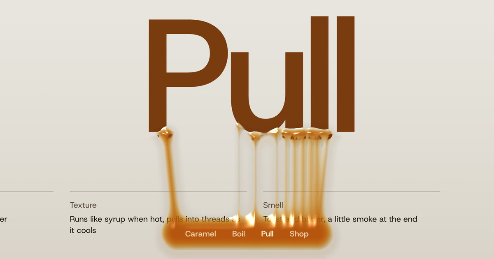

# Gooey Sticky Menu

A sticky menu that melts into the pictures it crosses as the page scrolls, pulling liquid strands from them that stretch, thin and snap.

[Article on Codrops](#)

[Demo](https://tympanus.net/Demos/GooeyStickyMenu/)

## Installation

Run this demo on a [local server](https://developer.mozilla.org/en-US/docs/Learn/Common_questions/Tools_and_setup/set_up_a_local_testing_server).

## Credits

- Smooth scrolling and the statement's lines with [GSAP](https://gsap.com) 3.15: ScrollTrigger, ScrollSmoother and SplitText
- Images generated in [Paper](https://paper.design)
- Font: [Host Grotesk](https://fonts.google.com/specimen/Host+Grotesk) by Element Type (SIL Open Font License 1.1, see `fonts/`)

## Misc

Follow Codrops: [X](https://x.com/codrops), [LinkedIn](https://www.linkedin.com/company/codrops/), [Instagram](https://www.instagram.com/codropsss/), [Facebook](https://www.facebook.com/codrops), [GitHub](https://github.com/codrops)

## License

[MIT](LICENSE)

Made with :blue_heart: by [Codrops](http://www.codrops.com)
